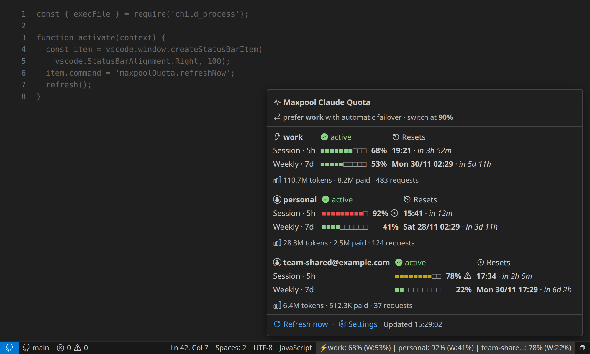
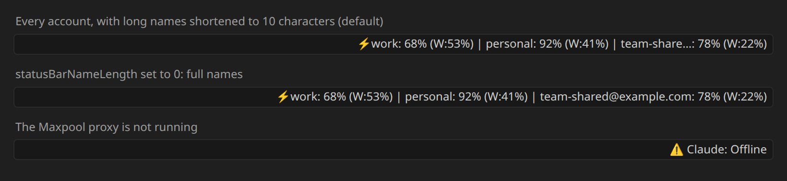

# Maxpool Claude Quota Bar

See how much of each Claude account's quota you have left, and when it resets, without leaving VS Code.

The extension reads usage from [Maxpool](https://github.com/2solarmax/maxpool), a proxy that spreads Claude Code traffic across several Claude accounts. It shows the 5-hour session and weekly usage of every account in the status bar. Hover it for a detailed card with reset times.



## Features

- **All accounts at a glance.** The status bar lists every account in Maxpool with its session and weekly percentage (`⚡work: 68% (W:53%)`). The account Maxpool currently routes to is marked with `⚡`. Names longer than 10 characters are shortened (`team-share…`); the hover card always shows the full name.
- **Reset times.** For each account, see when the 5-hour session and the weekly quota reset next. Times use a 24-hour clock in your machine's time zone, with a countdown (`19:10 · in 3h 52m`, `Fri 27/11 03:00 · in 5d 11h`).
- **Hover card you can use.** Hover the status bar item for usage meters, reset times and token totals per account. You can move the mouse into the card, which has **Refresh now** and **Settings** buttons.
- **Early warning in the card.** Inside the hover card, every meter turns yellow at 75% and red at 90% and gets a warning or error icon, so you never have to rely on color alone. The status bar itself stays plain text.
- **Click to refresh.** Click the status bar item to fetch the latest numbers right away. Usage also refreshes on its own every 15 seconds by default.
- **No setup.** The extension finds `maxpool` in common install locations, including `nvm`, and reads the proxy address from Maxpool's own config.

## Status bar



The status bar item is plain text with no background color, so it blends in with the rest of the status bar.

| Text | Meaning |
| :--- | :--- |
| `⚡work: 68% (W:53%)` | Session and weekly usage for each account. `⚡` marks the account Maxpool routes to. |
| `—` | Maxpool doesn't report that number for the account |
| `⚠️ Claude: Offline` | The Maxpool proxy is not reachable |
| `⚠️ Claude: No Acc` | Maxpool has no Claude accounts yet |

## Hover card

Hover the status bar item to open the card. Each account has its own section:

- **Session · 5h** and **Weekly · 7d** rows, each with a 10-segment meter, the percentage used and the next reset time
- A status badge (`active`, or a warning when Maxpool reports another status)
- Tokens used, paid tokens and the number of requests

The routing mode and switch threshold sit at the top. The **Refresh now** and **Settings** buttons and the time of the last update sit at the bottom. When the proxy is offline, the card explains how to start it and still offers both buttons.

## Requirements

- VS Code 1.75 or later
- [Maxpool](https://github.com/2solarmax/maxpool) installed, with at least one Claude account added, and the proxy running:

  ```bash
  npm install -g maxpool
  maxpool login
  maxpool server
  ```

## Installation

Install from a `.vsix` file:

```bash
code --install-extension maxpool-claude-quota-bar-<version>.vsix
```

Or build it from source:

```bash
git clone https://github.com/tungsfer512/maxpool-quota-bar.git
cd maxpool-quota-bar
npx @vscode/vsce package
code --install-extension maxpool-claude-quota-bar-*.vsix
```

Then run **Developer: Reload Window**.

## Settings

| Setting | Default | Description |
| :--- | :--- | :--- |
| `maxpoolQuota.binaryPath` | `""` | Full path to the `maxpool` executable. Leave empty to detect it automatically. |
| `maxpoolQuota.refreshIntervalSeconds` | `15` | How often usage refreshes, in seconds (minimum `5`). |
| `maxpoolQuota.statusBarNameLength` | `10` | Maximum characters shown for each account name in the status bar. Longer names end with `…`. Set to `0` to show full names. |

## Commands

| Command | Description |
| :--- | :--- |
| `Maxpool: Refresh Claude Quota Now` | Fetch the latest usage immediately. Clicking the status bar item does the same. |

## How it works

On every refresh the extension reads the proxy's `/maxpool/status` endpoint, the same data `maxpool status` prints. It gives every account, whatever its name looks like, with its status, session and weekly usage, reset times and token totals. The proxy address and API key come from Maxpool's config file, found the same way Maxpool finds it: `$MAXPOOL_CONFIG`, then `$XDG_CONFIG_HOME/maxpool.json`, then `~/.config/maxpool.json`.

If that fails, for example because the config file is somewhere else, the extension runs `maxpool status` and reads its text output instead. Usage still shows, but reset times don't, because the command doesn't print them.

The extension only talks to the local `maxpool` command and to the proxy address in Maxpool's config file. It sends no data anywhere else.

## Troubleshooting

- **The status bar shows "Claude: Offline".** Start the proxy with `maxpool server`, then click the status bar item or **Refresh now**. If `maxpool` isn't on a standard path, set `maxpoolQuota.binaryPath`.
- **Reset times show "—".** The extension couldn't reach `/maxpool/status` and fell back to `maxpool status`. Check that the proxy is running and that `proxy.port` and `proxy.apiKey` in Maxpool's config are correct. A session reset also shows "—" while an account hasn't started a session window yet.
- **The status bar shows "Claude: No Acc".** Maxpool has no Claude accounts yet. Add one with `maxpool login`.

## License

[MIT](LICENSE)

*Screenshots are rendered from the extension's own output with demo accounts.*
